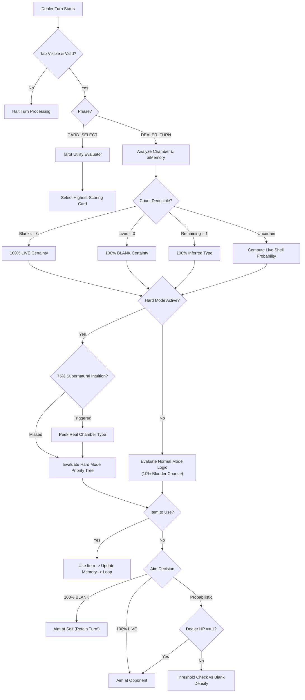
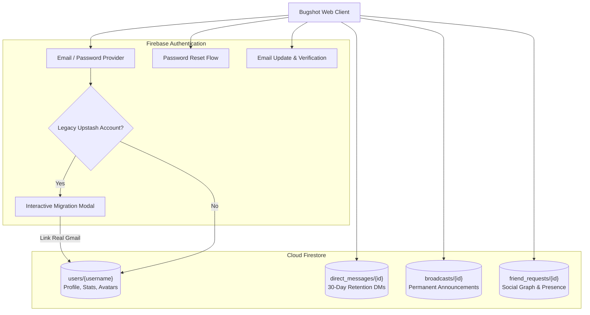
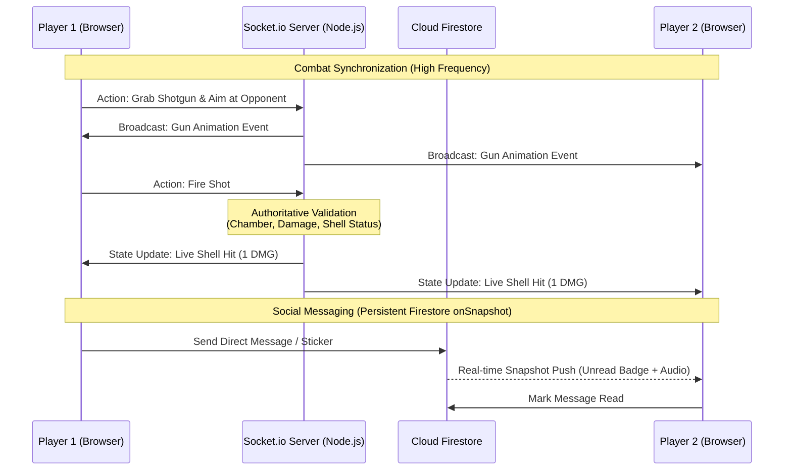
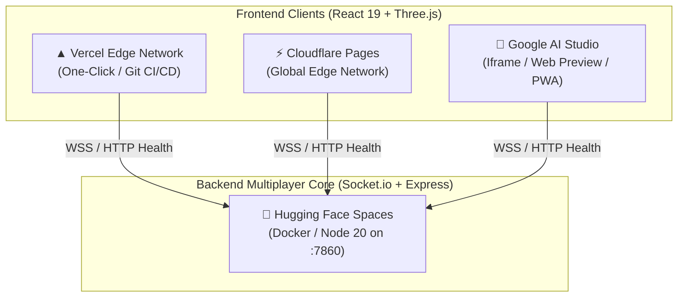
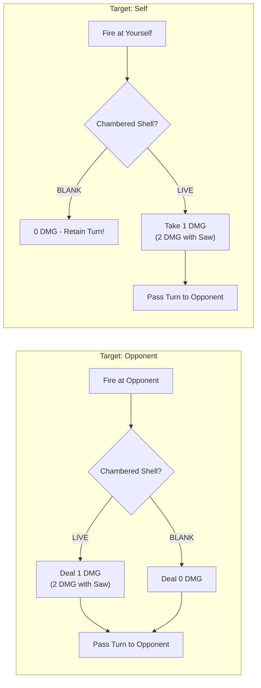
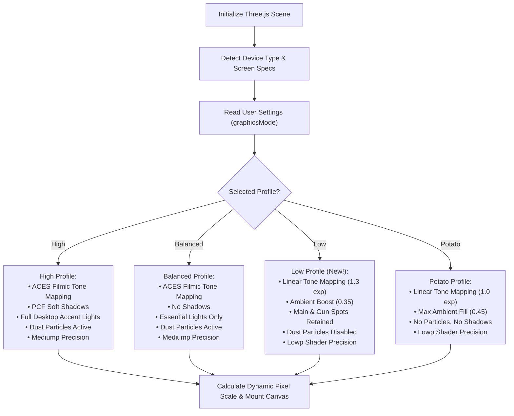

> ### ⚠️ **Important Notice & Inspiration**
> This game is **heavily inspired by Buckshot Roulette** by Mike Klubnika. No models, textures, or proprietary game scripts have been extracted from the original game files; all visual assets, 3D meshes, shaders, and source code are independently engineered and custom-crafted.
> 
> Certain item sound effects and ambient tracks were sourced from public royalty-free web repositories for non-commercial educational tribute purposes. If you hold rights to any audio asset and desire immediate removal or bespoke attribution, please open a GitHub issue for immediate handling.

---

<div align="center">

# 🎯 BUGSHOT ROULETTE


### *A High-Stakes Tabletop Horror Game of Probability, Nerve, and 12-Gauge Lead*

[](https://bugshotroulette.pages.dev/)
[](https://github.com/AadishY)
[](https://github.com/AadishY/BugShot-Roulette)
[](LICENSE)

---


*Enter the rusted underground chamber. Sign the waiver. Count the shells. Outsmart the Dealer.*

</div>

---

## 🎬 About the Project

**Bugshot Roulette** is a web-based, 3D tabletop horror experience built with **React 19**, **TypeScript**, and **Three.js / React Three Fiber**. Inspired by Mike Klubnika's breakout indie hit *Buckshot Roulette*, this project recreates the tension of high-stakes Russian Roulette played with a pump-action shotgun.

The project features a custom real-time 3D rendering pipeline with CRT retro post-processing, an intelligent Dealer AI featuring deductive chamber memory, a responsive mobile UI with coarse touch targets, authoritative multi-player lobbies (up to 4 players), and persistent Firebase Authentication and Firestore real-time messaging.

---

## 🎮 Gameplay Showcase

https://github.com/user-attachments/assets/e369969c-1fcc-43d0-994e-a4c02572d001

---

## 🕹️ Core Rules & How to Play

1. **Identity Clearance**: Enter your codename and click **Bind Soul** at the boot terminal.
2. **Chamber Loading**: A 12-gauge magazine holding 2 to 8 random shells is displayed. You are shown the exact breakdown of **LIVE** (red) and **BLANK** (blue) shells before they are loaded in random order.
3. **Tactical Item Phase**: Both combatants receive shipments of items. Use your inventory before picking up the gun to inspect the chamber, manipulate round polarities, skip turns, or steal enemy tools.
4. **Target Decision**:
   - **Shoot Opponent**: If the shell is **LIVE**, deals 1 damage (2 with Hand Saw) and your turn ends. If **BLANK**, deals 0 damage and turn passes.
   - **Shoot Yourself**: If the shell is **BLANK**, you take 0 damage and **retain your turn**! If **LIVE**, you take damage and surrender your turn.
5. **Survival of the Fittest**: Deplete your opponent's health to 0 HP while safeguarding your own. Advance through rounds to face the Dealer's escalating intelligence.

---

## 🖥️ Graphics Rendering Engine & The 4 Profiles

Bugshot Roulette features an adaptive 3D graphics pipeline configured across four discrete profiles. The engine balances atmospheric horror aesthetic against extreme framerate efficiency across devices ranging from high-end gaming rigs to budget mobile handsets.

### Profile Comparison Matrix

| Feature / Setting | 🌟 High (`'high'`) | ⚖️ Balanced (`'balanced'`) | ⚡ Low (`'low'`) | 🥔 Potato (`'potato'`) |
| :--- | :--- | :--- | :--- | :--- |
| **Target Hardware** | Gaming PCs, Dedicated GPUs | Modern Laptops, High-tier Phones | Budget Laptops, Mid-tier Mobile, iGPUs | Legacy Phones, Low-end Hardware |
| **Spotlight Lighting** | Full Main (5500) + Gun + Rim | Main (3500) + Gun + Rim | Main (3500) + Gun + Rim | Minimal Main Spotlight |
| **Ambient Light** | 0.15 (High Contrast) | 0.25 (Balanced) | 0.35 (Enhanced Bunker Visibility) | 0.45 (Max Ambient Fill) |
| **Heavy Desktop Lights** | Active (Accents, Walls, Generator) | Disabled | Disabled | Disabled |
| **Shadow Maps** | Enabled (`PCFSoftShadowMap`) | Disabled | Disabled | Disabled |
| **Tone Mapping** | `ACESFilmicToneMapping` (1.9 exp) | `ACESFilmicToneMapping` (1.6 exp) | `LinearToneMapping` (1.3 exp) | `LinearToneMapping` (1.0 exp) |
| **WebGL Precision** | `mediump` | `mediump` | `lowp` | `lowp` |
| **Dust Particles** | Active | Active | **Disabled (`null`)** | **Disabled (`null`)** |
| **Pixel Ratio (Cap)** | Desktop 2.0 / Mobile 1.6 | Desktop 1.35 / Mobile 1.25 | **Capped at 1.05** | **Capped at 1.00** |
| **Internal Pixel Scale** | Base (2.0x desktop / 1.6x mobile) | 2.4x desktop / 2.4x mobile | 3.2x desktop / 3.4x mobile | 4.2x desktop / 4.8x mobile |
| **Antialiasing** | Enabled (Desktop) | Disabled | Disabled | Disabled |

---

### ⚡ The New "Low" Profile: Architectural Breakdown

Prior engine iterations offered a stark dichotomy: the atmospheric, cinematic *Balanced* mode or the stark, high-gamma *Potato* mode. **"Low"** was engineered to solve the performance gap:

> [!TIP]
> **Why Choose "Low" Mode?**
> - **Retains Dramatic Lighting**: Unlike Potato mode (which washes out the dark industrial room with high ambient lighting), Low mode preserves the central warm overhead spotlight (`0xffddaa`), gun spotlight (`0xffeedd`), and Dealer rim light (`0xffa470`).
> - **Zero Shadow Overhead**: Drops costly shadow buffer passes entirely (`castShadow = false`), saving multiple draw calls per frame.
> - **Eliminates Particle Burden**: Completely bypasses the dust particle vertex computation loop (`createDust` returns `null`), preventing thousands of per-frame matrix recalculations.
> - **Lightweight Linear Tone Mapping**: Switches from trigonometric ACES Filmic tone mapping curves to fast `LinearToneMapping` with calibrated 1.3 exposure, optimizing fragment shader math on mobile GPUs.
> - **Shader Precision Step-Down**: Requests `lowp` floating-point precision from the WebGL context, reducing memory bandwidth usage on mobile Adreno and Mali chips.
> - **40%–60% FPS Increase**: Yields near-Potato framerates while retaining 90% of the game's claustrophobic bunker atmosphere.

---

## 🧠 Dealer AI Brain & Strategic Protocols

The Dealer is driven by a state machine paired with a dedicated deductive memory system (`aiMemory`). Rather than relying on simple coin flips, the Dealer tracks rounds, evaluates card utility, and adapts dynamically between defensive and lethal playstyles.



### 1. Deductive Chamber Memory (`aiMemory: Map<number, ShellType>`)
- **Intel Retention**: Memorizes specific chamber positions inspected via **Magnifying Glass** or revealed by the **Burner Phone**.
- **Chamber Inversion Tracking**: When using the **Inverter**, flips the known polarity at the current index. When deploying the **Big Inverter**, flips memory for all remaining shells in the magazine.
- **Mathematical Deduction**:
  - If visible `blankCount === 0` and `liveCount > 0`, deduced as **100% LIVE**.
  - If visible `liveCount === 0` and `blankCount > 0`, deduced as **100% BLANK**.
  - If only 1 shell remains in the magazine, deduced with **100% certainty** from the remaining counter without using an item.

### 2. Difficulty Tiers

#### Normal Mode
- **Human Flaws**: 10% chance per turn to make a mistake (50% chance to skip items entirely; 50% chance to select an item at random).
- **Aim Bluffing**: 8% chance to take an erratic bluff shot on uncertain shells.
- **Cautious Preservation**: Never shoots itself when at 1 HP unless 100% confirmed blank.
- **Standard Tarot Selection**: Selects Tarot cards randomly without peeking.

#### Hard Mode ("God Tier" Protocols)
- **Supernatural Gunpowder Intuition**: 75% innate chance per unknown shell to detect its exact polarity without consuming an item.
- **Tarot Peek & Scoring Matrix**: 90% chance to peek at face-down Tarot cards and calculate utility scores using `evaluateCardForDealer`:
  - **Justice** (Swap HP): Scored at `+10` if Dealer HP < Player HP; `-8` if Dealer HP > Player HP.
  - **Temperance** (Swap Items): Heavily prioritized if the Player holds key items (`SAW`, `CUFFS`, `TOTEM`).
  - **The Sun** (Heal): Scored at `+9` if Dealer is in critical danger (HP <= 2).
  - **The Hanged Man** (Self-Harm): Heavily penalized (`-12`) at low health.
- **Strict Tactical Decision Tree**:
  1. **Survival Healing**: Immediate `CIGS` consumption when damaged (100% priority at <= 2 HP).
  2. **Synergy Combos**: Executes `LUCKYCHARM` immediately before `CONTRACT` when HP >= 3.
  3. **Early Intel Gathering**: Uses `GLASS` before committing lethal items (`SAW`, `CHOKE`, `INVERTER`).
  4. **Jackpot Counter-Play**: If the player has Jackpot Immunity, uses `INVERTER` to flip live rounds to blanks and shoots itself to burn turns without wasting damage.
  5. **Anti-Totem Stripping**: Deploys `FLASHBANG` or `CRUSHER` to neutralize the player's Totem of Undying before firing lethal sawed shots.
  6. **Safe Beer Cycling**: Never racks a known blank. Safely discards dangerous live rounds with Beer when facing an immune player or when stuck at 1 HP.

---

## 📱 Mobile Optimizations & Responsive Controls

Bugshot Roulette provides a responsive mobile interface built for touchscreens:

```
┌────────────────────────────────────────────────────────┐
│ [Esc] [⚙️]          [STATUS / LOGS]          [CHAT 💬]  │
├────────────────────────────────────────────────────────┤
│                                                        │
│                    3D TABLETOP VIEW                    │
│                 (Interactive Raycasting)               │
│                                                        │
├────────────────────────────────────────────────────────┤
│ ◄ [Scroll Indicator]  INVENTORY CAROUSEL  [Indicator] ►│
│ ┌──────┐ ┌──────┐ ┌──────┐ ┌──────┐ ┌──────┐ ┌──────┐   │
│ │ CIGS │ │ SAW  │ │ BEER │ │ GLASS│ │ CUFF │ │ INV  │   │
│ └──────┘ └──────┘ └──────┘ └──────┘ └──────┘ └──────┘   │
├────────────────────────────────────────────────────────┤
│     [  🎯 SHOOT OPPONENT  ]     [  💀 SHOOT SELF  ]     │
│             (40px+ Minimum Touch Hitboxes)             │
└────────────────────────────────────────────────────────┘
```

- **Touch Target Expansion**: Every interactive element (fire buttons, inventory slots, chat controls, modal dismissals) adheres to a **40px+ minimum touch target** dimension to prevent missed clicks.
- **Two-Step Mobile Item Activation**:
  - *Tap 1*: Highlights the item and displays a detailed description tooltip at the bottom-right.
  - *Tap 2*: Confirms and triggers item execution. Outside-touch listener automatically closes tooltips.
- **Dynamic Scroll Masks**: The horizontal inventory ribbon incorporates gradient scroll masks (`showLeftMask`, `showRightMask`) that appear dynamically whenever items overflow the viewport.
- **Safe-Area Padding**: Uses CSS environment variables (`env(safe-area-inset-top)`, `env(safe-area-inset-bottom)`) to ensure HUD elements never collide with device notches, camera punch-holes, or navigation bars.
- **Adaptive Touch Aiming**: In 3-player and 4-player multiplayer, tapping an opponent previews the shotgun aim, while a second tap fires.

---

## ☁️ Firebase Cloud Architecture & Authentication

Player identity, telemetry, real-time messaging, and progression are managed through a unified **Firebase Cloud** backend, with graceful offline fallback to `localStorage`.



### 1. Authentication Features
- **Email & Password Authentication**: Standard registration and login with encrypted token management.
- **Self-Service Password Reset**: Direct `sendPasswordReset` pipeline with automatic spam/promotions folder client alerts.
- **Email Update Flow**: Verified email migration via `verifyBeforeUpdateEmail` requiring inbox confirmation before commit.
- **Upstash Migration Engine**: Detects legacy accounts (without valid verified emails) and prompts players with an interactive Migration Modal to bind a Gmail address without losing stats.
- **Offline Fallback Guarantee**: If Firebase services are unreachable or credentials are not configured, the game automatically falls back to local storage so single-player matches are never blocked.

### 2. Firestore Document Collections
- `users/{username}`: Stores user profile dossiers, Dicebear avatar configurations, total play time, win/loss tallies, and hard mode clears.
- `direct_messages/{messageId}`: Real-time private direct messages between players with automatic 30-day lifecycle retention.
- `broadcasts/{broadcastId}`: Permanent global administrative announcements and patch notes.
- `friend_requests/{requestId}`: Real-time friend requests (`pending`, `accepted`, `declined`) and mutual friendship rosters.

---

## 🌐 Real-Time Multiplayer & Messaging System

Bugshot Roulette implements a **hybrid networking architecture** separating high-frequency authoritative combat from persistent social communications:



### Combat Layer (Socket.io)
- **Authoritative Chamber Validation**: All chamber rolls, live/blank distributions, damage calculations, and turn handoffs are validated on the server to prevent client-side tampering.
- **Multi-Player Scalability**: Supports 1v1 duels, 3-player Mexican standoffs, and 4-player free-for-all tables with dynamic seat orientation and directional aiming.
- **In-Game Match Chat**: Fast, ephemeral in-game chat box with player team colors, tactical callouts, and combat log integration.

### Social Layer (Cloud Firestore `onSnapshot`)
- **Direct Messaging**: 1-on-1 private player conversations with audio notifications, unread count badges, and sticker reactions.
- **Friend System**: Search players by `@username` or unique `@playerid#code`, send/accept friend requests, and inspect friend profiles.
- **Global Broadcasts**: System-wide announcements pushed in real-time to all online clients.

---

## 🔧 Comprehensive Item Guide

| Icon | Item Name | Gameplay Effect & Tactical Strategy |
| :---: | :--- | :--- |
| 🚬 | **Cigarettes** | Restores 1 HP (capped at max). Always use when damaged. |
| 🍺 | **Beer** | Ejects the chambered shell without firing it. Displays ejected round type. Does not consume Choke status. |
| 🔗 | **Handcuffs** | Skips the opponent's next turn. Cannot stack if opponent is already cuffed. |
| 🔍 | **Magnifying Glass** | Secretly inspects the chambered shell (LIVE or BLANK). Essential for planning Saw attacks. |
| ✂️ | **Hand Saw** | Saws off shotgun barrel: doubles shot damage from 1 to 2 HP for the current turn. Stacks with Choke. |
| 📞 | **Burner Phone** | Reveals the polarity of a random future shell (3rd or higher). 5% chance the caller lies. |
| 🔄 | **Inverter** | Inverts the chambered shell's polarity (LIVE ↔ BLANK). Does not reveal the original type. |
| 💉 | **Adrenaline** | Steals an item from the opponent's inventory and consumes it immediately. Cannot steal Totem or Adrenaline. |
| 📡 | **Remote** | Swaps the chambered shell with the next consecutive shell in the magazine. Requires >= 2 shells. |
| ⚡ | **Big Inverter** | Inverts the polarity of **ALL** remaining shells in the magazine. Devastating when blanks dominate. |
| 🥋 | **Choke** | Modifies barrel to fire the current and next shell simultaneously. Double Live = 2 DMG. Saw doubles total. |
| 🩸 | **Blood Contract** | Sacrifices 1 HP to draw 2 high-tier items. Using at 1 HP is fatal. Max 1 per inventory. |
| 🍀 | **Lucky Charm** | Multiplies loot rarity on next shipment. Stacks with Blood Contract for guaranteed top-tier loot. |
| 💥 | **Flashbang** | Blinds opponent: disables all item usage on their next turn. They may still shoot. |
| 🔨 | **Crusher** | Crushes and destroys 1 random item in the opponent's inventory. Can destroy Totems. |
| 🌟 | **Totem of Undying** | **[PASSIVE]** Auto-saves user at 1 HP upon receiving lethal damage. Cannot be stolen via Adrenaline. |
| 🪞 | **Mirror** | Replays every item effect used by the opponent on their preceding turn, in exact sequence. |
| 🃏 | **Tarot Deck** | Fans 6 random cards on the table. Player flips 1 card to trigger mystical active or passive effects. |
| 🎰 | **Jackpot Machine** | Spins 3 slot reels: 20% chance for 3-shot bullet immunity, 30% for 1-shot immunity, 50% loss. |

---

## 🃏 Tarot Card Deck

When using the **Tarot Deck** item, 6 cards are fanned face-down on the tabletop:

| Card Face | Type / Tone | Gameplay Effect Description |
| :--- | :---: | :--- |
| **The Magician** | Active (Purple) | Draw 1 random bonus item (discarded if inventory full). |
| **The Hanged Man** | Penalty (Red) | Suffer 1 HP damage. Triggers Totem of Undying if lethal. |
| **The Hermit** | Penalty (Grey) | Immediately forfeits your turn to the opponent without shooting. |
| **The Moon** | Active (Blue) | Steal 1 random item from opponent (excluding Totem). |
| **Judgment** | Active (Yellow) | If chambered shell is BLANK, 50% chance to secretly convert to LIVE. |
| **Wheel of Fortune** | Active (Orange) | Shuffles all remaining shells in the chamber, resetting prior intel. |
| **The Sun** | Active (Yellow) | Restore 1 HP (capped at maximum health). |
| **Death** | Penalty (Zinc) | Destroys 1 random item from your own inventory (can destroy Totem). |
| **The Tower** | Active (Amber) | Destroys 1 random item from the opponent's inventory. |
| **The Fool** | Active (Pink) | Reveals shell polarity. (Lie chance: 0% at 3+ shells, 10% at 2 shells, 25% at 1 shell). |
| **Justice** | Active (Emerald) | Swaps your current HP with the opponent's current HP. |
| **Temperance** | Active (Sky Blue) | Swaps your entire item inventory with the opponent's inventory. |

---

## 📊 Drop Rates & Item Balancing

### Player Item Probability Matrix

| Item | Normal Mode | Hard Mode |
| :--- | :---: | :---: |
| **Blood Contract** | **9.0%** | **7.0%** |
| **Beer** | **10.0%** | **15.0%** |
| **Cigarettes** | **9.0%** | **4.0%** |
| **Magnifying Glass** | **7.0%** | **8.0%** |
| **Handcuffs** | **7.0%** | **8.0%** |
| **Burner Phone** | **8.0%** | **8.0%** |
| **Hand Saw** | **5.0%** | **5.0%** |
| **Inverter** | **7.0%** | **8.0%** |
| **Adrenaline** | **7.0%** | **7.0%** |
| **Choke** | **5.0%** | **5.0%** |
| **Big Inverter** | **4.0%** | **4.0%** |
| **Lucky Charm** | **4.0%** | **4.0%** |
| **Flashbang** | **5.0%** | **5.0%** |
| **Crusher** | **3.0%** | **3.0%** |
| **Mirror** | **4.0%** | **4.0%** |
| **Tarot Deck Card** | **3.0%** | **4.0%** |
| **Totem of Undying** | **1.0%** | **1.0%** |
| **Jackpot Slot Machine** | **2.0%** | **1.0%** |

*Note: Unique items (Blood Contract, Lucky Charm, Totem) are limited to 1 per inventory.*

---

## 🛠️ Installation & Local Development

### Prerequisites
- [Node.js](https://nodejs.org/) (version 18+ recommended)
- [npm](https://www.npmjs.com/) or [yarn](https://yarnpkg.com/)

### Quick Start

```bash
# 1. Clone the repository
git clone https://github.com/AadishY/BugShot-Roulette.git
cd BugShot-Roulette

# 2. Install dependencies
npm install

# 3. Setup environment variables (optional, fallback to local storage)
cp .env.example .env

# 4. Launch development server
npm run dev

# 5. Build production bundle
npm run build
```

---

## 🚢 Turnkey Cloud Deployment Guides

Bugshot Roulette is architected for zero-friction turnkey deployment across modern static edge CDNs and containerized cloud hosting platforms.



### 1. ▲ Vercel Deployment

Deploy the web client to Vercel with automated CI/CD and production SPA routing.

[](https://vercel.com/new/clone?repository-url=https%3A%2F%2Fgithub.com%2FAadishY%2FBugShot-Roulette&env=VITE_SERVER_URL&envDescription=Backend%20Socket.io%20Server%20URL%20(e.g.%20Hugging%20Face%20Space%20URL)&project-name=bugshot-roulette&repository-name=bugshot-roulette)

#### Project Configuration Settings:
| Parameter | Value | Details |
| :--- | :--- | :--- |
| **Framework Preset** | `Vite` | Vercel automatically detects Vite configurations |
| **Root Directory** | `./` | Root of repository |
| **Build Command** | `npm run build` | Compiles production assets into `dist/` |
| **Output Directory** | `dist` | Static bundle folder |
| **Install Command** | `npm install` | Installs root dependencies |

#### Environment Variables:
- `VITE_SERVER_URL`: URL of your multiplayer backend (e.g., `https://<your-username>-bugshot-server.hf.space` or custom domain).

> [!NOTE]
> The included [`vercel.json`](vercel.json) configures SPA rewrites (`/(.*) -> /index.html`), 1-year immutable caching on `/assets/`, and critical Content-Security-Policy headers permitting embedding inside Google AI Studio preview frames (`frame-ancestors 'self' https://aistudio.google.com https://*.google.com https://*.googleusercontent.com;`).

---

### 2. ⚡ Cloudflare Pages Deployment

Deploy globally to Cloudflare's ultra-low latency edge network.

#### Option A: Cloudflare Dashboard (Git Integration)
1. Log in to the [Cloudflare Dashboard](https://dash.cloudflare.com/) and navigate to **Workers & Pages** > **Create application** > **Pages** > **Connect to Git**.
2. Select your `BugShot-Roulette` repository.
3. Configure build settings:
   - **Framework Preset**: `Vite`
   - **Build Command**: `npm run build`
   - **Build Output Directory**: `dist`
   - **Root Directory**: `/`
4. In **Environment Variables**, add:
   - `NODE_VERSION`: `20` (or `18`)
   - `VITE_SERVER_URL`: `https://<your-space-name>.hf.space`
5. Click **Save and Deploy**.

#### Option B: Wrangler CLI (Direct Upload)
```bash
# Build the production bundle
npm run build

# Deploy directly via Wrangler
npx wrangler pages deploy dist --project-name=bugshot-roulette
```

---

### 3. 🤖 Google AI Studio Integration

Bugshot Roulette is pre-configured to run directly within **Google AI Studio** interfaces, chat prompts, and web preview frames as an interactive agentic web application.

#### Features & Architectural Compatibility:
- **Iframe Embedding Clearance**: The web app emits explicit `Content-Security-Policy` headers with `frame-ancestors 'self' https://aistudio.google.com https://*.google.com https://*.googleusercontent.com;`, eliminating `X-Frame-Options: DENY` browser blocks.
- **Web Preview Integration**: The Three.js WebGL canvas automatically computes viewport dimensions using `window.innerWidth` and dynamic CSS `100dvh`, resizing cleanly within AI Studio side-panel webviews without canvas clipping.
- **Standalone PWA Mode**: Complete with `public/manifest.json`, high-resolution icons (`pwa-192x192.png`, `pwa-512x512.png`), theme colors, and orientation locks (`landscape`), allowing installation directly from Chrome/Edge as a native desktop or mobile PWA.
- **Safe Audio Unlock**: Fallback audio routines seamlessly handle sandboxed iframe autoplay policies with graceful silent recovery until user interaction unlocks Web Audio.

#### Embedding Code Snippet:
```html
<iframe
  src="https://bugshotroulette.pages.dev"
  title="Bugshot Roulette"
  width="100%"
  height="720px"
  allow="autoplay; fullscreen; microphone; camera; display-capture"
  style="border: none; border-radius: 12px; overflow: hidden;"
></iframe>
```

---

### 4. 🤗 Hugging Face Spaces (Backend Docker Deployment)

Deploy the authoritative Node.js/Socket.io multiplayer server to Hugging Face Spaces on standard port **7860**.

#### Turnkey Setup:
1. Create a new Space on [Hugging Face](https://huggingface.co/new-space).
2. Choose **Docker** as the Space SDK and set Space visibility to **Public**.
3. Push the files in the [`server/`](server/) directory to your Space repository:
   ```bash
   cd server
   git init
   git remote add space https://huggingface.co/spaces/<your-username>/<your-space-name>
   git add .
   git commit -m "Deploy Bugshot Roulette Core Server"
   git push space main
   ```
4. Hugging Face automatically detects the metadata frontmatter in [`server/README.md`](server/README.md):
   ```yaml
   ---
   title: Bugshot Roulette Core Server
   emoji: 🔫
   colorFrom: red
   colorTo: gray
   sdk: docker
   app_port: 7860
   pinned: false
   ---
   ```
5. The container builds using the production [`server/Dockerfile`](server/Dockerfile):
   - Base image: `node:20-slim`
   - Port exposure: `EXPOSE 7860`
   - Environment: `ENV PORT=7860`, `ENV NODE_ENV=production`
   - Entry point: `CMD [ "node", "index.js" ]`
6. Your backend server is live at: `https://<your-username>-<your-space-name>.hf.space`!
   - Container health check: `GET https://<your-space-name>.hf.space/health`
   - Live Radar Terminal UI: `GET https://<your-space-name>.hf.space/`

#### Connecting Frontend to Backend:
Set your frontend deployment's `VITE_SERVER_URL` environment variable:
```env
VITE_SERVER_URL=https://<your-username>-<your-space-name>.hf.space
```
The server's universal CORS matrix automatically permits incoming WebSocket and HTTP requests from your Vercel (`*.vercel.app`), Cloudflare Pages (`*.pages.dev`), and Google AI Studio origins.

---

## 🚀 Tech Stack

<div align="center">

| Technology | Badge | Description |
| :--- | :--- | :--- |
| **React 19** |  | Reactive UI components & game state |
| **Three.js** |  | 3D scene graph, lighting & models |
| **TypeScript** |  | Strict type safety across game loops |
| **Vite** |  | Blazing fast build tooling and HMR |
| **TailwindCSS** |  | CRT interface, responsive HUD & modals |
| **Socket.io** |  | Low-latency combat synchronization |
| **Firebase** |  | Auth, Firestore database & messaging |

</div>

---

## 🗺️ System Architecture Flowcharts

### 1. Shot Resolution Matrix



### 2. Graphics Mode Configuration Pipeline



---

## 🏆 Credits & Acknowledgments

Bugshot Roulette is a fan-made, non-profit tribute project built to demonstrate modern web-based 3D graphics, real-time multiplayer systems, and agentic AI game design.

### 🎮 Original Game & Concept
*   **Mike Klubnika** ([Official Site](https://mikeklubnika.com/) | [Itch.io](https://mikeklubnika.itch.io/)) — The visionary creator of the original **Buckshot Roulette**. This web experience exists purely out of admiration for his masterful game design and atmosphere. Support the official release on [Steam](https://store.steampowered.com/app/283550/Buckshot_Roulette/) and [Itch.io](https://mikeklubnika.itch.io/buckshot-roulette).

### 🎨 3D Assets
*   **Dealer Model**: [VibaPop](https://sketchfab.com/VibaPop) via Sketchfab.
*   **Hand Model**: [bttkller](https://sketchfab.com/bttkller) via Sketchfab.

### 🔊 Audio & Sound Effects
*   Atmospheric soundscapes and sound effects inspired by and attributed to [buckshot-decomp-public](https://github.com/uncreativeCultist/buckshot-decomp-public) and public domain web archives.

---

## 👤 Created & Engineered By

<div align="center">

### **Aadish**
**Creator, Lead Architect & Developer**

[](https://github.com/AadishY)
[](https://bugshotroulette.pages.dev/)

*All game code, AI architectures, Three.js shaders, Firebase integrations, and mobile interfaces were designed and engineered by **Aadish**.*

</div>

---

## 📄 License & Governance

- **License**: [MIT License](LICENSE) &copy; 2024–2026 Aadish
- **Code of Conduct**: [CODE_OF_CONDUCT.md](CODE_OF_CONDUCT.md)
- **Contributing Guidelines**: [CONTRIBUTING.md](CONTRIBUTING.md)
- **Security Policy**: [SECURITY.md](SECURITY.md)
- **Firebase Guide**: [FIREBASE.md](FIREBASE.md)
